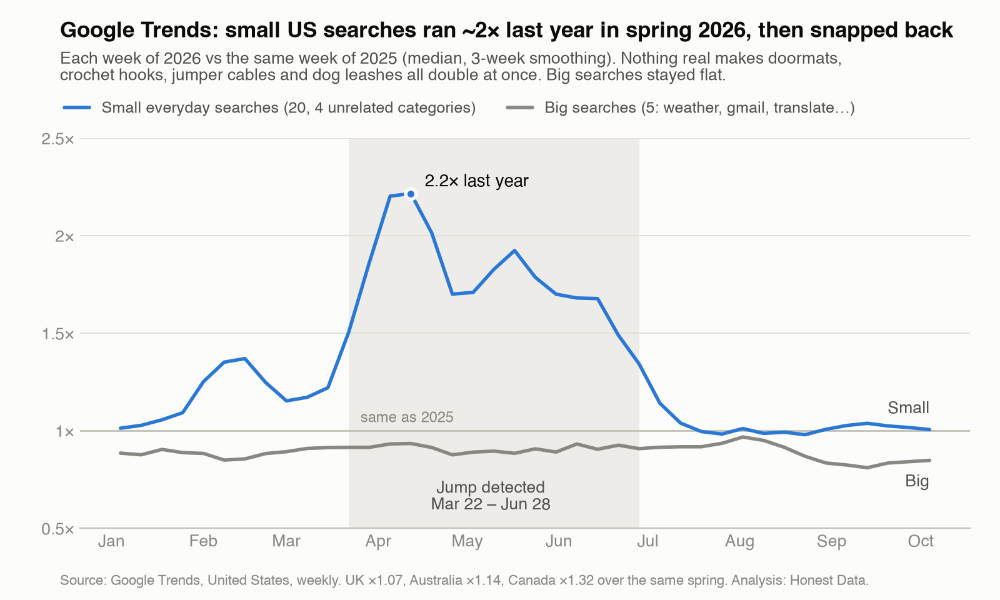

# Google Trends, spring 2026: small US searches doubled, then snapped back

**Finding.** From the week of March 22 to the week of June 14, 2026, 20 unrelated everyday US
searches ran **1.5 to 2.2 times** their 2025 level, all at the same time (peak: 2.2× in the week of
April 12). They eased off over the next five weeks and were back to their 2025 level by mid-July.
Big searches stayed flat over the same weeks, at 0.88 to 0.93 of their 2025 level. A smaller rise came first, in
February (up to 1.37× in the week of Feb 15).

Nothing real makes doormats, crochet hooks and jumper cables double at once. It looks like a change
in how Google sampled low-volume US searches, not a change in demand. We haven't found a note from
Google about it.

**It's mostly a US effect.** The same comparison run for other countries over the same spring gave
×1.07 for the UK, ×1.14 for Australia and ×1.32 for Canada (those series aren't in this folder).

## What it means

- Growth for long-tail terms that compares spring 2026 with anything else is inflated.
- Peak dates between late March and late June 2026 are suspect.
- Big head terms look fine.

## Data

[`data.csv`](data.csv): one row per week of 2026 (Jan 4 to Oct 4).

| Column | Meaning |
|---|---|
| `week` | Week start (Sunday), as Google Trends reports it |
| `small_searches_vs_2025 (median of 20 terms)` | Median, across 20 small everyday terms, of that week's value divided by the same week of 2025 |
| `big_searches_vs_2025 (median of 5 terms)` | The same for 5 big terms: weather, gmail, translate, calculator, facebook |

1.0 means the same as the year before.

## Method

- **Terms.** 20 small, unrelated US searches in 4 groups. Household: shower curtain, doormat, dish
  rack, and others. Hobby: crochet hook, jigsaw puzzle, and others. Auto and tools: jumper cables,
  wiper blades, and others. Pets and garden: dog leash, cat litter, and others. Plus 5 big
  searches.
- **Data.** Weekly values from 5-year Google Trends pulls, US. A term's 2026 week and its 2025 week
  come from the same pull, so Google's per-request scaling cancels out in the ratio.
- **Ratio.** Each week of 2026 is divided by the same week of 2025, so seasonality cancels out. The
  median is taken across the terms in each group.

**Check your own keywords.** Pull a few unrelated control terms of similar size next to yours. If
the controls jump together, the jump is Google's data, not your keyword. The
[Google Trends tool](https://apify.com/honestdata/google-trends-one-scale) runs this check on every
run and flags the affected dates.

Data and chart: [CC BY 4.0](https://creativecommons.org/licenses/by/4.0/), credit "Honest Data".
